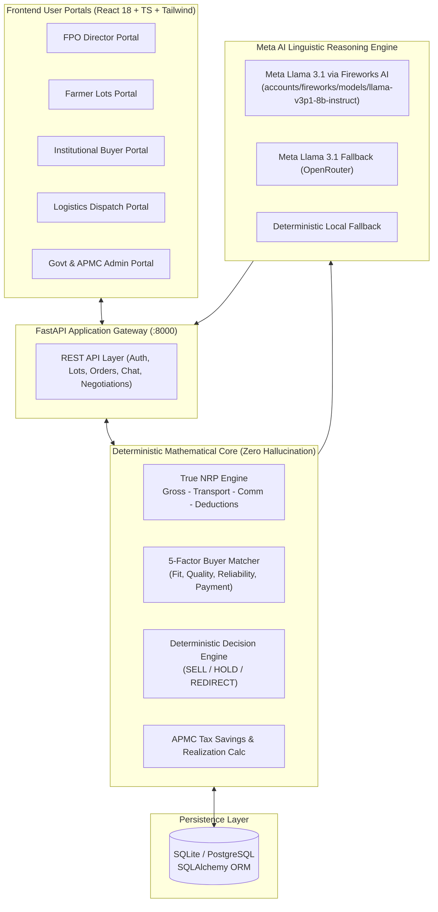

# MahaVipanan AI 🌾

> **Meta Hackathon 2026 Submission**  
> **Theme:** Sustainable Agriculture, Decision Intelligence & Vernacular AI  
> **Powered by:** Meta Llama 3.1 & Fireworks AI Partner Inference Engine  
> **Repository:** [https://github.com/your-org/mahavipanan-ai](https://github.com/your-org/mahavipanan-ai)

[](https://ai.meta.com/llama/)
[](https://fireworks.ai/)
[](https://fastapi.tiangolo.com/)
[](https://react.dev/)
[](backend/tests/)
[](LICENSE)

An end-to-end decision-intelligence and trade execution platform for **Farmer Producer Organisations (FPOs)** and agricultural cooperatives. MahaVipanan AI eliminates the **"Gross Quoted Price Trap"** by computing the **True Net Realizable Price (NRP)**—what farmers *actually take home* after transit loss, freight, loading, APMC mandi taxes, and quality deductions—coupled with a **Meta Llama 3.1-powered Multilingual Agri-CA & Negotiation Copilot**.

---

## 📌 Table of Contents

- [The Core Problem: The Gross Price Trap](#-the-core-problem-the-gross-price-trap)
- [Meta Hackathon 2026 Spotlight](#-meta-hackathon-2026-spotlight)
  - [Use of Meta Products](#use-of-meta-products)
  - [Why Meta Llama 3.1 is Critical](#why-meta-llama-31-is-critical)
  - [Experience with Partner Technologies (Fireworks AI)](#experience-with-partner-technologies-fireworks-ai)
  - [Responses to Hackathon Evaluation Prompts](#responses-to-hackathon-evaluation-prompts)
- [System Architecture & Hybrid AI Blueprint](#-system-architecture--hybrid-ai-blueprint)
- [Key Platform Features](#-key-platform-features)
- [Tech Stack](#-tech-stack)
- [Quick Start Guide](#-quick-start-guide)
  - [Prerequisites](#prerequisites)
  - [1. Backend Setup](#1-backend-setup)
  - [2. Environment Configuration](#2-environment-configuration)
  - [3. Database Seeding](#3-database-seeding)
  - [4. Frontend Setup](#4-frontend-setup)
- [Interactive Demo Walkthrough](#-interactive-demo-walkthrough)
- [API Reference](#-api-reference)
- [Verification & Automated Tests](#-verification--automated-tests)
- [Repository Structure](#-repository-structure)
- [Security & Zero-Hallucination Design](#-security--zero-hallucination-design)
- [License & Acknowledgments](#-license--acknowledgments)

---

## 🌾 The Core Problem: The Gross Price Trap

In India's agricultural supply chain, FPO directors and farmers face a recurring financial deception: **the buyer quoting the highest headline price often pays the lowest net realization.**

When an FPO sells a 100-quintal lot:
- **Buyer A (City Trader):** Quotes **₹2,100/q** headline price. After factoring 140 km transit freight (₹150/q), APMC mandi cess (6% = ₹126/q), and loading charges (₹25/q), the FPO nets **₹1,799/q**.
- **Buyer B (Local Processor):** Quotes **₹2,020/q** headline price. Being 25 km away with direct-marketing APMC tax exemption and minimal transit loss, the FPO nets **₹1,940/q**.

> **Outcome:** Choosing Buyer A based on headline price costs the farmer pool **₹14,100 in lost net revenue** on a single truckload.

MahaVipanan AI solves this by computing the deterministic **True Net Realizable Price (NRP)** and utilizing **Meta Llama 3.1** to explain trade-offs and negotiate counter-offers in vernacular languages.

$$\text{NRP} = \text{Gross Price} - (\text{Transport} + \text{Loading} + \text{Commission/Mandi Cess} + \text{Quality Deduction} + \text{Transit Risk})$$

---

## 🚀 Meta Hackathon 2026 Spotlight

### Use of Meta Products
MahaVipanan AI integrates **Meta Llama 3.1 (8B & 70B Instruct)** as the primary linguistic reasoning and advisory intelligence engine throughout the platform:
1. **Decision Explanation Engine (`ai_explanation.py`):** Translates complex 5-dimensional multi-factor mathematical rankings (NRP, distance, payment terms, quality tolerances, buyer reliability) into concise, 3-sentence plain-language justifications for rural FPO board members.
2. **Autonomous Agri-CA & Scheme Advisor (`chat.py`):** A conversational copilot fluent in English, Hindi, Marathi, and Telugu that evaluates produce lots, calculates 6% APMC mandi tax exemptions under Direct Marketing licenses, and matches published government welfare subsidies.
3. **Adaptive Negotiation Copilot (`negotiation_advice.py`):** Operates within mathematical price-safety guardrails (MSP floor vs. Ideal Selling Price) to draft tactical counter-offers and generate contextual negotiation messages for trade partners.

### Why Meta Llama 3.1 is Critical
- **Open-Weights & Edge Deployment:** Agriculture in rural India requires local deployment options. Meta's open-weights architecture allows FPOs to deploy models locally or across national sovereign data centers without recurring per-token cloud vendor lock-in.
- **Multilingual Nuance:** Llama 3.1 exhibits superior semantic coherence across Indic languages (Hindi, Marathi, Telugu) when guided by localized system prompts, preventing unnatural literal translations of agricultural jargon.
- **Low-Latency Function Reasoning:** Llama 3.1 8B offers an ideal balance of reasoning depth and sub-300ms latency, critical for responsive real-time chat on rural 4G connections.

### Experience with Partner Technologies (Fireworks AI)
In this project, Meta Llama 3.1 is served via **Fireworks AI** (`accounts/fireworks/models/llama-v3p1-8b-instruct`), an official Meta inference partner:
- **Sub-250ms Time-to-First-Token (TTFT):** Essential for conversational agricultural advisory without user drop-off.
- **OpenAI-Compatible REST Spec:** Enabled drop-in integration into Python `httpx` async pipelines without bulky third-party SDK dependencies.
- **High Concurrency & Cost Efficiency:** Allowed our multi-factor decision pipeline to run synchronous batch explanations during radar recalculation with zero timeout errors.

### Responses to Hackathon Evaluation Prompts

| Hackathon Prompt | Our Response |
|---|---|
| **What was the biggest obstacle your team hit while building this project?** | Preventing Large Language Model hallucinations in agricultural trade mathematics. Farmers cannot afford an AI inventing fictitious freight rates, inaccurate APMC tax calculations, or illegal counter-offers below statutory Minimum Support Price (MSP). We solved this via a **Strict Hybrid Architecture**: all mathematics, tax logic, and price zones are computed deterministically in Python/SQLAlchemy; Meta Llama 3.1 acts purely as a semantic explainer, grounded advisor, and linguistic translator. |
| **When your team chooses an AI model or coding tool, what matters most?** | 1. **Instruction-following precision under strict JSON/data constraints**.<br>2. **Deployment flexibility (open weights for sovereign/on-prem FPO edge servers)**.<br>3. **Low inference latency (<300ms) with cost-effective scaling**. |
| **What makes it hardest for your team to switch to a different AI model or coding tool?** | Prompt fragility across regional languages. Different models handle Indic language syntax and agricultural domain framing inconsistently, requiring extensive re-tuning of system prompt delimiters and safety boundaries. |
| **If your team took this project to production, what would most likely stop you from using Meta’s model?** | Lack of managed sovereign hosting infrastructure in Tier-3 rural Indian districts. While Llama's open weights allow self-hosting, rural agricultural cooperatives require fully managed, ultra-low-cost, distributed edge runtimes with vernacular speech-to-text (e.g., seamless integration with Meta SeamlessM4T). |

---

## 🏛 System Architecture & Hybrid AI Blueprint



---

## 🌟 Key Platform Features

### 1. Market Opportunity Radar (True NRP Engine)
- Ranks institutional buyers strictly by **Net Realizable Price (₹/quintal)**, not headline gross quotes.
- Provides transparent, itemized cost breakdowns (transport cost, APMC mandi fees, loading charges, quality deductions, and transit risks).
- Recommends deterministic actions: **SELL** (highest NRP), **HOLD** (market trend favorable), or **REDIRECT** (alternative aggregation hub).

### 2. Transporter "What-If" Sensitivity Simulator
- Allows FPO directors to type in a live transporter freight quote or alternate distance.
- The entire buyer matrix re-sorts in real time with zero page reload, instantly highlighting if a freight change flips the most profitable buyer.

### 3. Meta Llama 3.1 Multilingual Agri-CA & Copilot
- Conversational assistant fluent in **English, Hindi, Marathi, and Telugu**.
- Automatically computes **Direct Marketing 6% APMC tax exemptions** saving lakhs of rupees for cooperatives.
- Matches active farmers with published Central and State government welfare schemes (PMFBY, Soil Health Card, e-NAM).

### 4. Price-Safe Negotiation Assistant
- Classifies incoming trade offers into algorithmic price zones:
  - 🔴 **Below Safe Floor:** Below Minimum Support Price (MSP) or production cost.
  - 🟡 **Negotiable:** Within workable margin; suggests fair mathematical counter-bands.
  - 🟢 **Strong:** Near or above Ideal Selling Price (ISP).
- Generates contextual, culturally respectful counter-offer letters powered by Meta Llama.

### 5. Live GPS Logistics & Order Tracking Map
- Live visual shipment map with stage checkpoints: `Matched` ➔ `Order Created` ➔ `Vehicle Dispatched` ➔ `In-Transit` ➔ `Delivered` ➔ `Settled`.
- Automated milestone updates for drivers, buyers, and FPO dispatchers.

### 6. Five Role-Based Actor Dashboards
- **Farmer Dashboard:** Create and track produce lots with quality metrics (moisture %, foreign matter %, grain size).
- **FPO Director Dashboard:** Aggregate village inventory, compare buyer bids, and execute bulk dispatches.
- **Buyer Dashboard:** Browse verified FPO lots, place bids, negotiate counter-offers, and track fulfillment.
- **Delivery Transporter Dashboard:** Manage transit waybills, update checkpoint statuses, and record delivery timestamps.
- **Admin & Govt Officer Dashboard:** Monitor regional trade flow, verify FPO licenses, and sync official government subsidy portals.

---

## 💻 Tech Stack

| Layer | Component | Version / Tech |
|---|---|---|
| **AI Reasoning** | Meta Llama 3.1 8B Instruct | `accounts/fireworks/models/llama-v3p1-8b-instruct` |
| **AI Partner Engine**| Fireworks AI | High-speed serverless inference API |
| **Backend Framework** | FastAPI | Python 3.12+ (Asynchronous ASGI) |
| **ORM & Database** | SQLAlchemy 2.0+ | SQLite (Demo/Development) / PostgreSQL (Prod) |
| **Data Validation** | Pydantic V2 | Strict type enforcement & input sanitization |
| **Frontend UI** | React 18 + Vite 5 | TypeScript + Tailwind CSS |
| **Icons & Motion** | Lucide React + Framer Motion | Fluid micro-interactions and clean UI |
| **Localization** | Custom Vernacular i18n | English, Hindi (हिंदी), Marathi (मराठी), Telugu (తెలుగు) |
| **Automated Testing** | Pytest + httpx TestClient | 23/23 unit and integration tests passing |

---

## ⚡ Quick Start Guide

Follow these simple steps to run the complete platform locally using Command Prompt (CMD) or PowerShell on Windows, or Terminal on Linux/macOS.

### Prerequisites
- **Python 3.11+ or 3.12+** ([python.org](https://www.python.org/downloads/))
- **Node.js 18+ or 20+** ([nodejs.org](https://nodejs.org/))
- **Git** ([git-scm.com](https://git-scm.com/))

---

### 1. Backend Setup

Open a terminal in the project directory:

```bash
# Navigate to the backend folder
cd backend

# Create a virtual environment
python -m venv venv

# Activate the virtual environment
# On Windows (CMD / PowerShell):
venv\Scripts\activate
# On Linux / macOS:
source venv/bin/activate

# Install required dependencies
pip install -r requirements.txt
```

---

### 2. Environment Configuration

Create your local backend environment configuration:

```bash
# In the backend directory:
copy .env.example .env     # On Windows CMD
cp .env.example .env       # On Linux / macOS / PowerShell
```

Edit `backend/.env` with your API keys:

```env
# Meta Llama & Partner AI (Fireworks AI)
FIREWORKS_API_KEY=your_fireworks_api_key_here
FIREWORKS_MODEL=accounts/fireworks/models/llama-v3p1-8b-instruct
META_LLAMA_MODEL=accounts/fireworks/models/llama-v3p1-8b-instruct

# Secondary / Fallback Providers (Optional)
OPENROUTER_API_KEY=your_openrouter_api_key_here
OPENROUTER_MODEL=meta-llama/llama-3.1-8b-instruct:free
GEMINI_API_KEY=
LLM_API_KEY=

# Database & Runtime
DATABASE_URL=sqlite:///./mahavipanan.db
DEMO_MODE=true
SECRET_KEY=supersecretkey_change_in_production
CORS_ORIGINS=http://localhost:5173,http://localhost:3000,http://127.0.0.1:5173
```

> **Note on Graceful Degradation:** Even with zero API keys entered, MahaVipanan AI will run 100% of its mathematical calculations, lot listings, and UI features using built-in deterministic templates.

---

### 3. Database Seeding & Launching Backend

Initialize the database with synthetic Maharashtra agricultural lots, verified institutional buyers, and published government welfare schemes:

```bash
# From the backend directory with venv activated:
python seed_db.py

# Launch the FastAPI backend server:
uvicorn app.main:app --reload --port 8000
```

- **Backend API URL:** `http://localhost:8000`
- **Interactive Swagger Documentation:** `http://localhost:8000/docs`
- **API Health Check:** `http://localhost:8000/health`

---

### 4. Frontend Setup

Open a **new** terminal window in the project root folder:

```bash
# Install frontend npm dependencies
npm install

# Start the Vite development server
npm run dev
```

- **Frontend Application URL:** `http://localhost:5173`

---

## 🎯 Interactive Demo Walkthrough

1. **Access the App:** Open `http://localhost:5173` in your web browser.
2. **Select Persona:** Click **"Login"** and select any demo persona:
   - **FPO Director (Kisan Vikas FPO, Nashik):** Inspect 500 quintals of Sharbati Wheat and Soybeans.
   - **Farmer (Ramesh Patil):** Create a new harvest lot with quality metrics.
   - **Institutional Buyer (BigBasket Sourcing):** Browse lots and submit counter-offers.
   - **Transporter (Mahalaxmi Agro Logistics):** Update GPS transit waypoints.
   - **Govt Admin:** Review direct-marketing licenses and compliance.
3. **Explore Opportunity Radar:** Open **Market Opportunities** on any lot. View how buyers are ranked strictly by **Net Realizable Price (NRP)** rather than gross quotes.
4. **Test Real-Time Freight Correction:** Adjust freight from ₹120/q to ₹350/q in the **"Freight What-If"** widget; watch the ranking automatically re-order and flip the recommended buyer.
5. **Read Meta Llama 3.1 Explanation:** Notice the plain-language 3-sentence justification under *"Why This Buyer?"* powered by Meta Llama.
6. **Chat with Multilingual Agri-CA:** Click the AI assistant bubble at the bottom right.
   - Ask in Hindi: `"क्या मुझे मंडी टैक्स में छूट मिलेगी?"`
   - Ask in Marathi: `"सोयाबीन साठी सरकारी योजना सांगा"`
   - Ask in English: `"Calculate net profit for 100 quintals of wheat at 2200 per quintal"`
7. **Track Order in Real-Time:** Head to **Live Orders** to view the live Leaflet dispatch map showing route progress and delivery checkpoints.

---

## 📡 API Reference

| Method | Endpoint | Description |
|---|---|---|
| `GET` | `/health` | API health check and database connectivity status |
| `GET` | `/api/fpo/dashboard` | High-level metrics: total inventory, active lots, realized value |
| `GET` | `/api/lots/` | List all produce lots with crop, grade, and moisture data |
| `POST` | `/api/lots/` | Register a new farmer produce lot |
| `GET` | `/api/opportunities/{lot_id}` | Calculate true NRP, match scores, and Meta Llama recommendations |
| `POST` | `/api/opportunities/{lot_id}/recalculate` | Re-run NRP engine with custom transporter freight override |
| `POST` | `/api/chat/` | Multi-turn vernacular Agri-CA chat powered by Meta Llama 3.1 |
| `POST` | `/api/negotiations/{id}/suggest` | Compute negotiation safety zone and suggested counter-offer band |
| `GET` | `/api/orders/` | List orders with delivery stages and live GPS coordinate tracks |
| `GET` | `/api/schemes/` | Fetch verified government agricultural welfare subsidies |

Full interactive OpenAPI testing docs available at `http://localhost:8000/docs`.

---

## 🧪 Verification & Automated Tests

MahaVipanan AI maintains a comprehensive automated test suite covering deterministic mathematical correctness, API error handling, and LLM fallback safety.

To run the complete test suite:

```bash
# Run all backend tests from the project root:
python -c "import sys, pytest; sys.path.insert(0, 'backend'); sys.exit(pytest.main(['backend/tests']))"
```

**Test Suite Coverage (23 Passed, 0 Failed):**
- ✅ `test_nrp_engine.py`: Verifies mathematical integrity of gross deductions, freight rates, and net realizations.
- ✅ `test_buyer_match.py`: Verifies 5-factor scoring dimensions (quantity fit, quality tolerance, reliability, payment terms).
- ✅ `test_decision_engine.py`: Verifies deterministic SELL, HOLD, and REDIRECT state transitions.
- ✅ `test_ai.py`: Verifies Meta Llama API integration, Fireworks client handling, and graceful deterministic fallback.
- ✅ `test_ownership_and_auth.py`: Validates role-based permissions and secure lot access.
- ✅ `test_api.py` & `test_e2e_workflow.py`: End-to-end integration tests across full trade lifecycles.

To verify the frontend build:

```bash
npm run build
# Compiles with 0 TypeScript errors: ✓ built in ~23s
```

---

## 📂 Repository Structure

```
mahavipanan-ai/
├── backend/                             # FastAPI Python Backend
│   ├── app/
│   │   ├── main.py                     # ASGI entrypoint, CORS & exception handlers
│   │   ├── config.py                   # Environment settings (Meta Llama & Fireworks keys)
│   │   ├── database.py                 # SQLAlchemy database session & engine
│   │   ├── deps.py                     # Security, JWT auth & user dependencies
│   │   ├── models/
│   │   │   └── core.py                 # ORM models (Lots, Buyers, Orders, Schemes)
│   │   ├── schemas/
│   │   │   └── core.py                 # Pydantic request/response schemas
│   │   ├── routers/                    # REST API Endpoints
│   │   │   ├── admin.py                # Admin compliance & FPO verification
│   │   │   ├── auth.py                 # Authentication & profile management
│   │   │   ├── chat.py                 # Multi-turn Meta Llama Agri-CA assistant
│   │   │   ├── delivery.py             # Transporter waybills & dispatch tracking
│   │   │   ├── farmer.py               # Farmer inventory & harvest registration
│   │   │   ├── fpo.py                  # FPO aggregation dashboard
│   │   │   ├── lots.py                 # Lot creation, updates & status transitions
│   │   │   ├── negotiations.py         # Multi-round trade counter-offers
│   │   │   ├── opportunities.py        # NRP ranking & freight override radar
│   │   │   ├── orders.py               # Order lifecycle & settlement management
│   │   │   ├── schemes.py              # Official government scheme directory
│   │   │   └── simulator.py            # Market scenario & price shock simulator
│   │   ├── services/                   # Business & Intelligence Logic
│   │   │   ├── ai_explanation.py       # Meta Llama 3.1 plain-language decision explainer
│   │   │   ├── ai_provider.py          # Fireworks AI & OpenRouter Meta Llama inference
│   │   │   ├── buyer_match.py          # 5-factor multi-criteria buyer ranking
│   │   │   ├── decision_engine.py      # SELL / HOLD / REDIRECT state machine
│   │   │   ├── geocode.py              # Haversine distance & transit calculation
│   │   │   ├── negotiation_advice.py   # MSP price-safety zones & counter-ranges
│   │   │   └── nrp_engine.py           # True Net Realizable Price formula engine
│   │   └── seed/
│   │       └── demo_data.py            # Synthetic trade data (lots, buyers, schemes)
│   ├── tests/                          # Automated Pytest Suite (23/23 passing)
│   ├── seed_db.py                      # Database initialization CLI script
│   ├── requirements.txt                # Python backend dependencies
│   └── .env.example                    # Backend environment template
├── src_new_ui/                          # React 18 + Vite 5 Frontend
│   ├── api/                            # Axios/Fetch API client and contracts
│   ├── components/                     # Reusable UI Component Library
│   │   ├── brand/                      # Platform logos & badge indicators
│   │   ├── charts/                     # NRP waterfall & buyer comparison charts
│   │   ├── layout/                     # AppShell, TopNav & sidebar navigation
│   │   ├── map/                        # LiveOrderMap (interactive dispatch tracking)
│   │   └── radar/                      # Opportunity cards & freight override tools
│   ├── pages/                          # Role-Specific Portals
│   │   ├── Opportunities.tsx           # True NRP Market Radar
│   │   ├── FarmerLots.tsx              # Farmer harvest registration
│   │   ├── FPOLots.tsx                 # FPO inventory aggregation
│   │   ├── BuyerDashboard.tsx          # Institutional procurement
│   │   ├── DeliveryDashboard.tsx       # Transporter dispatch management
│   │   └── GovtDashboard.tsx           # Scheme administration & compliance
│   ├── lib/                            # Internationalization (i18n) & utilities
│   └── state/                          # Application context & global state
├── public/                             # Static web assets & icons
├── .env.example                        # Frontend environment template
├── package.json                        # Node dependencies & build scripts
├── vite.config.ts                      # Vite configuration & build optimizations
└── README.md                           # Master Project Documentation
```

---

## 🔒 Security & Zero-Hallucination Design

1. **Mathematical Grounding:** Financial numbers (net proceeds, commission, taxes, transit costs) are strictly calculated in Python before being passed to the LLM. Meta Llama 3.1 is forbidden by system instructions from inventing or extrapolating monetary figures.
2. **Statutory Floor Protection:** Negotiation suggestions enforce statutory Minimum Support Price (MSP) boundaries, preventing distress selling.
3. **Zero Frontend Key Exposure:** All API tokens (Fireworks AI, OpenRouter) reside strictly within the protected backend environment (`backend/.env`).
4. **Graceful Fallbacks:** If network latency or API quotas affect external LLM calls, the platform seamlessly falls back to local deterministic rule templates without interrupting user workflow.

---

## 📄 License & Acknowledgments

- **License:** Open-source under the [MIT License](LICENSE).
- **Meta Hackathon 2026:** Submitted in competition celebrating the impact of open-source AI and developer innovation.
- **Inference Partner:** Accelerated with [Fireworks AI](https://fireworks.ai/) high-performance Meta Llama 3.1 serverless endpoints.
- **Dedicated to:** The Farmer Producer Organisations (FPOs) and agriculturalists of rural India.
